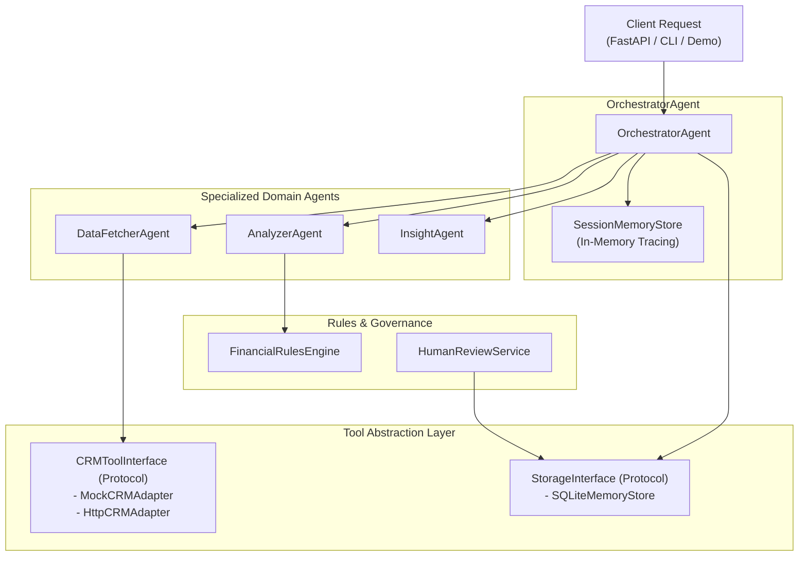

# Wealth Advisor Multi-Agent System

[](https://www.python.org/)
[]()
[](https://fastapi.tiangolo.com)
[](https://docs.pydantic.dev/)
[-success.svg)]()

A lightweight, production-ready multi-agent Wealth Advisor Assistant engineered in Python for Glynac (Acumen Strategy). The system ingests client financial data, queries mock/remote CRM context, executes explainable rule-based anomaly detection, produces evidence-backed advisory insights, and supports human-in-the-loop review workflows with graceful error degradation.

---

## Table of Contents
1. [Problem Statement & Solution](#1-problem-statement--solution)
2. [Architecture & Agent Responsibilities](#2-architecture--agent-responsibilities)
3. [End-to-End Execution Flow](#3-end-to-end-execution-flow)
4. [Tool Abstraction & Extensibility](#4-tool-abstraction--extensibility)
5. [Anomaly Detection Logic & Configurable Thresholds](#5-anomaly-detection-logic--configurable-thresholds)
6. [Reliability, Error Handling & Observability](#6-reliability-error-handling--observability)
7. [Memory Systems: Session & Historical Persistence](#7-memory-systems-session--historical-persistence)
8. [Human-in-the-Loop Review System](#8-human-in-the-loop-review-system)
9. [Engineering Trade-offs & Design Decisions](#9-engineering-trade-offs--design-decisions)
10. [Setup, Execution & Testing Commands](#10-setup-execution--testing-commands)
11. [Example Requests & Output Schemas](#11-example-requests--output-schemas)
12. [Security, Privacy & Financial Advice Disclaimer](#12-security-privacy--financial-advice-disclaimer)
13. [Future Improvements](#13-future-improvements)

---

## 1. Problem Statement & Solution

### The Challenge
Wealth managers and financial analysts often deal with fragmented client financial feeds: raw bank export JSONs, CRM profiles, and investment holdings. Traditional manual review is slow and error-prone, while generic black-box generative AI agents frequently suffer from hallucinations, non-deterministic math, high cloud costs, and security risks.

### The Solution
This solution provides a **modular, deterministic multi-agent system** that:
- **Normalizes and Validates**: Cleans dates, amounts, transaction types, and detects malformed inputs automatically.
- **Enriches with Context**: Queries CRM customer profiles with timeout boundaries and retry logic.
- **Detects Anomalies Explainably**: Runs statistical and deterministic rules with leave-one-out baselines.
- **Separates Facts from Hypotheses**: Produces advisory insights strictly differentiating observed mathematical facts from plausible explanations and recommended advisor actions.
- **Degrades Gracefully**: If upstream services (e.g. CRM) fail or time out, the system yields complete financial summaries in partial-result mode without crashing.
- **Empowers Humans**: Provides audit trails for advisors to approve, reject, or override findings without ever initiating autonomous trades.

---

## 2. Architecture & Agent Responsibilities

The system decouples responsibility across specialized agents and protocols:



### Agent Responsibilities
| Agent / Component | Primary Responsibility | Failure Strategy |
| :--- | :--- | :--- |
| **`OrchestratorAgent`** | Coordinates workflow lifecycle, manages state, merges human review history, formats final report. | Catches downstream exceptions, marks partial results, produces comprehensive report. |
| **`DataFetcherAgent`** | Validates & normalizes dates (ISO 8601), amounts, types, and retrieves client CRM context. | Retries transient errors (exponential backoff); falls back to transaction-only mode on failure. |
| **`AnalyzerAgent`** | Computes gross income, expenditures, net cash flow, savings rate, and executes anomaly rules. | Quarantines malformed items; evaluates portfolio rules only when holdings data is present. |
| **`InsightAgent`** | Synthesizes findings into actionable recommendations with strict fact/hypothesis separation. | Downgrades confidence scores on partial results or data warnings. |
| **`HumanReviewService`** | Records advisor decisions (`APPROVE`, `REJECT`, `OVERRIDE`) with audit timestamps and notes. | Enforces strict non-execution invariant: never triggers trades or fund movements. |

---

## 3. End-to-End Execution Flow

A typical analysis request executes in the following sequence:

1. **Request Ingestion**: Upstream caller submits `AnalyzeRequest` via REST API or CLI.
2. **Correlation ID Generation**: Middleware assigns or extracts `X-Correlation-ID` to track logs across async calls.
3. **Session Initialization**: `OrchestratorAgent` registers a new `SessionContext` in `SessionMemoryStore`.
4. **Data Ingestion & Normalization**:
   - `DataFetcherAgent` fetches CRM profile from `CRMToolInterface` (with timeout and retries).
   - Normalizes raw transactions: converts negative expense values to positive magnitudes, standardizes ISO dates, flags future dates.
5. **Quantitative Analysis**:
   - `AnalyzerAgent` aggregates inflows and outflows.
   - Evaluates deterministic anomaly rules via `FinancialRulesEngine`.
   - Derives risk indicators (e.g. negative cash flow, portfolio concentration).
6. **Insight Generation**:
   - `InsightAgent` generates advisory recommendations separating facts, hypotheses, and next steps.
7. **Human Review Sync**:
   - `OrchestratorAgent` queries `StorageInterface` for prior advisor review records matching the finding IDs and updates their status.
8. **Long-Term Persistence**:
   - The analysis summary is saved to SQLite for historical trend tracking.
9. **Response Delivery**: Return structured `AnalysisResponse` with complete execution traces and duration metrics.

---

## 4. Tool Abstraction & Extensibility

Agents interact with external dependencies strictly via **Python Protocols** (`@runtime_checkable Protocol`) rather than direct SDK couplings:

```python
# app/tools/interfaces.py
@runtime_checkable
class CRMToolInterface(Protocol):
    async def get_client_profile(
        self,
        client_id: str,
        timeout: Optional[float] = None,
        simulate_failure: bool = False,
        simulate_timeout: bool = False
    ) -> CRMClientData:
        ...

@runtime_checkable
class StorageInterface(Protocol):
    def save_analysis_summary(self, client_id: str, session_id: str, summary_data: Dict[str, Any]) -> None: ...
    def get_client_history(self, client_id: str, limit: int = 50) -> List[Dict[str, Any]]: ...
    def save_review(self, review: ReviewRecord) -> None: ...
    def get_review_for_finding(self, finding_id: str) -> Optional[ReviewRecord]: ...
```

### Extending to a Real Production CRM
A production REST adapter is provided in `app/tools/http_crm.py`. To connect to an enterprise CRM:
1. Initialize `HttpCRMAdapter(base_url="https://crm.internal/api", api_key=...)`.
2. Inject it into FastAPI dependency injection (`app/api/dependencies.py`).
3. Zero changes are needed in `DataFetcherAgent` or `OrchestratorAgent`.

---

## 5. Anomaly Detection Logic & Configurable Thresholds

All anomaly detection rules are deterministic, auditable, and configurable via environment variables:

| Anomaly Type | Detection Logic | Limitations & Verification |
| :--- | :--- | :--- |
| **`LARGE_TRANSACTION_ABSOLUTE`** | Single expense exceeds configured threshold (default: `$5,000.00`). | Evaluates single magnitude only. Legitimate tax settlements or capital expenditures may trigger this; does not prove fraud. |
| **`CATEGORY_SPENDING_OUTLIER`** | Expense exceeds $N \times$ category baseline mean (default: $3.0\times$) using a **leave-one-out** baseline. Minimum 3 records required. | Requires minimum 3 observations; periodic bulk purchasing or annual software renewals may trigger this. |
| **`MONTHLY_SPENDING_SPIKE`** | Latest month spending exceeds prior months' baseline average by $\ge 50\%$ (ratio $\ge 1.5$). Requires $\ge 2$ months history. | Seasonal holiday expenses or planned home improvements naturally elevate monthly outflow. |
| **`DUPLICATE_TRANSACTION`** | Identical amounts and vendor/merchant within a 48-hour sliding window. | Legitimate repeat purchases (e.g., daily commuter transit passes or duplicate coffee orders) may match. |
| **`PORTFOLIO_CONCENTRATION_RISK`** | Single asset class constitutes $\ge 60\%$ of total portfolio value. Evaluated **only** when portfolio data exists. | Concentrated holdings may be intentional (e.g. founder equity). Rebalancing should be verified with the client. |
| **`RISK_PROFILE_MISMATCH`** | Client risk profile is `CONSERVATIVE` in CRM, but equity exposure exceeds $50\%$. | Market appreciation may have caused portfolio drift; update suitability profile with client. |

---

## 6. Reliability, Error Handling & Observability

### Bounded Retries & Timeouts
- External calls to CRM enforce a default **2.0-second timeout**.
- Transient connection failures undergo **exponential backoff retries** (up to 3 attempts).
- Permanent errors (e.g. 404 client not found) fail fast without retrying.

### Graceful Degradation (Partial Results)
If CRM context is unavailable, the pipeline does not abort:
- `system_status.partial_result` is set to `true`.
- `system_status.crm_status` is logged as `FAILED`.
- Transactional and cash flow analysis continues unimpeded.
- Advisory insights adjust their confidence scores downwards.

### Observability & PII Sanitization
- **Distributed Tracing**: Every request carries an `X-Correlation-ID` header.
- **Timing Traces**: Every agent stage records execution duration in milliseconds.
- **Log Masking**: Custom logging formatter sanitizes PANs (13–16 digit cards), SSNs (`\d{3}-\d{2}-\d{4}`), Bearer tokens, and secrets from all log streams.

---

## 7. Memory Systems: Session & Historical Persistence

### Short-Term Session Memory (`SessionMemoryStore`)
- Stores in-flight workflow stage, agent execution durations, intermediate artifacts, and data quality warnings.
- Supports active session inspection via `GET /sessions/{session_id}`.
- Enforces LRU memory bounds to prevent memory leaks.

### Long-Term Persistent Memory (`SQLiteMemoryStore`)
- **ACID Compliant**: Local SQLite database (`wealth_advisor.db`) storing analysis summaries and human reviews.
- **Client Isolation**: All historical queries require `client_id` partitioning. Records for Client A are never visible to Client B.
- **Automated Retention Pruning**: Built-in cleanup deletes historical records older than 90 days (`prune_old_records`).

---

## 8. Human-in-the-Loop Review System

Flagged anomalies require human discretion before taking client action. The `HumanReviewService` supports three advisor actions:

1. **`APPROVE`**: Confirms the finding as valid (e.g. client confirms an unusual luxury purchase).
2. **`REJECT`**: Dismisses false positives (e.g. recurring annual software subscription).
3. **`OVERRIDE`**: Adjusts finding severity or provides updated explanation notes.

```bash
# Example: Submit Human Review Decision
POST /reviews/3714e83e5ea490bf?client_id=client_002
{
  "decision": "APPROVE",
  "reviewer_id": "ADV_SARAH_CONNER",
  "reviewer_notes": "Client verified purchase of anniversary gift with invoice."
}
```

> **Strict Safety Invariant**: The review service records decisions to an immutable audit table. It has zero capability to trigger trades, debit bank accounts, or execute financial transactions.

---

## 9. Engineering Trade-offs & Design Decisions

Detailed in [docs/design-decisions.md](file:///C:/Users/ACER/.gemini/antigravity/scratch/wealth-advisor-agent-system/docs/design-decisions.md):
- **Deterministic Math over LLM Hallucinations**: Rule engines compute mathematical sums and standard deviations deterministically, eliminating calculation errors.
- **Zero Paid LLM Dependencies**: Completely offline execution with zero API keys required, running in under 100ms.
- **Leave-One-Out Outlier Baselines**: Eliminates statistical distortion where an extreme outlier inflates its own mean.
- **Fail-Open Partial Mode**: Ensures advisors are never locked out of analyzing transactions due to a temporary CRM hiccup.

---

## 10. Setup, Execution & Testing Commands

### Prerequisites
- Python 3.11, 3.12, or 3.13
- Git

### 1. Installation
```powershell
# Clone or navigate to the repository
cd C:\Users\ACER\.gemini\antigravity\scratch\wealth-advisor-agent-system

# Install dependencies
pip install -r requirements.txt
```

### 2. Run the Automated End-to-End Demo
Executes all 6 business scenarios (normal, anomalous, CRM failure, malformed data, human review, client history):
```powershell
python run_demo.py
```

### 3. Run the Test Suite (29 Tests)
```powershell
pytest -v
```

### 4. Start the FastAPI Web Service
```powershell
uvicorn app.api.main:app --host 127.0.0.1 --port 8000 --reload
```
Interactive Swagger UI documentation is available at:
**[http://127.0.0.1:8000/docs](http://127.0.0.1:8000/docs)**

### 5. CLI Analysis
```powershell
python -m app.cli analyze --file data/sample_client_anomalous.json --client-id client_002
```

---

## 11. Example Requests & Output Schemas

### Request: `POST /analyze`
```json
{
  "client_id": "client_002",
  "client_profile": {
    "transactions": [
      {
        "id": "tx_a10",
        "date": "2026-10-04",
        "amount": 8500.0,
        "type": "expense",
        "category": "luxury",
        "merchant": "Cartier Fine Jewelers",
        "description": "Anniversary watch"
      }
    ]
  },
  "mock_crm_failure": false
}
```

### Response: `200 OK`
```json
{
  "metadata": {
    "session_id": "sess_03373cc20ee9",
    "correlation_id": "req_a1b2c3d4",
    "timestamp": "2026-10-17T22:30:00Z",
    "duration_ms": 78.4
  },
  "client_id": "client_002",
  "financial_summary": {
    "total_income": 75000.0,
    "total_expenses": 21414.98,
    "net_cash_flow": 53585.02,
    "savings_rate_pct": 71.45,
    "category_breakdown": {
      "luxury": 8500.0,
      "housing": 6400.0,
      "travel": 4500.0,
      "dining": 1510.0
    },
    "transaction_count": 14
  },
  "anomaly_findings": [
    {
      "finding_id": "3714e83e5ea490bf",
      "anomaly_type": "LARGE_TRANSACTION_ABSOLUTE",
      "severity": "MEDIUM",
      "relevant_transaction_ids": ["tx_a10"],
      "observed_value": "$8,500.00",
      "comparison_baseline": "$5,000.00 (configured threshold)",
      "explanation": "Transaction tx_a10 of $8,500.00 at 'Cartier Fine Jewelers' exceeds the absolute threshold of $5,000.00.",
      "limitations": "Rule evaluates single transaction magnitude only; legitimate capital purchases or tax payments may trigger this rule; does not prove fraud or misconduct.",
      "recommended_verification": "Verify invoice or vendor contract with the client to confirm authorization and tax classification.",
      "review_status": "PENDING"
    }
  ],
  "actionable_insights": [
    {
      "insight_id": "ins_cf_c20ee9",
      "category": "CASH_FLOW",
      "title": "Cash Flow Trajectory: Surplus ($53,585.02)",
      "observed_facts": [
        "Total income recorded: $75,000.00.",
        "Total living and operational expenses: $21,414.98.",
        "Net period cash flow: $53,585.02 over 14 transactions."
      ],
      "possible_explanations": [
        "Client maintains positive operating cash flow during the evaluated interval."
      ],
      "suggested_next_steps": [
        "Assess whether surplus cash can be routed toward tax-advantaged savings or emergency liquidity."
      ],
      "confidence_score": 1.0,
      "disclaimer": "Advisory insight generated for analytical review only. Does not constitute binding investment advice..."
    }
  ],
  "system_status": {
    "partial_result": false,
    "crm_status": "CONNECTED",
    "execution_traces": [
      {"agent": "DataFetcherAgent", "stage": "ingest_and_normalize", "duration_ms": 5.2, "status": "SUCCESS"},
      {"agent": "AnalyzerAgent", "stage": "financial_analysis", "duration_ms": 2.1, "status": "SUCCESS"},
      {"agent": "InsightAgent", "stage": "insight_generation", "duration_ms": 1.4, "status": "SUCCESS"}
    ]
  }
}
```

---

## 12. Security, Privacy & Financial Advice Disclaimer

1. **Non-Execution Safety Invariant**: This software is strictly an analytical aid. It is prohibited from executing financial transactions, placing stock orders, transferring capital, or freezing accounts.
2. **Not Financial or Investment Advice**: Output generated does not constitute legal, tax, or financial advisory counsel under SEC, FINRA, or FCA regulations.
3. **Privacy & Redaction**: The system actively sanitizes sensitive PANs, SSNs, and credentials before writing to log streams.
4. **Client Isolation**: Historical memory partitions data per `client_id`, preventing cross-client data leakage.

---

## 13. Future Improvements

1. **Vector-Augmented Historical RAG**: Connect client historical summaries into a local vector database (e.g. ChromaDB / FAISS) for natural language semantic trend analysis.
2. **Real-Time Webhook Streaming**: Emit Server-Sent Events (SSE) or WebSockets during agent workflow transitions for interactive dashboard rendering.
3. **Pluggable ML Outlier Detectors**: Introduce unsupervised Isolation Forests or Local Outlier Factor (LOF) models alongside deterministic rules for multidimensional spending anomaly clustering.
