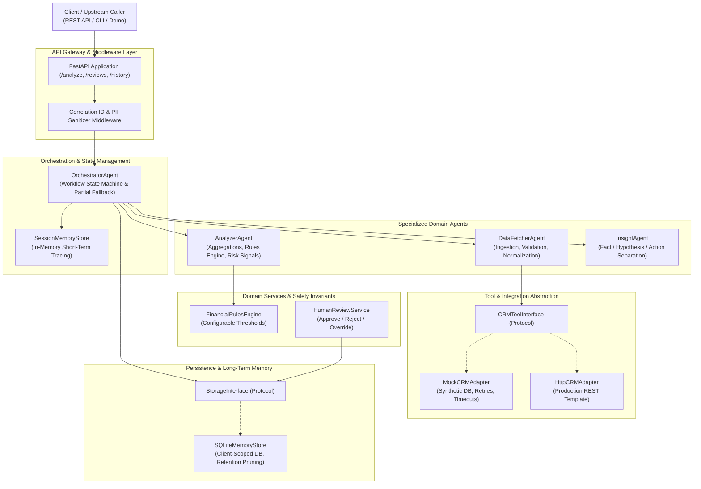

# System Architecture & Technical Specifications

## 1. Architectural Philosophy

The **Wealth Advisor Multi-Agent System** is designed around principles of:
- **Deterministic Explainability**: Financial advisory systems require auditable, repeatable calculations rather than black-box stochastic generation.
- **Strict Separation of Concerns**: Specialized agents own distinct stages of the analytical lifecycle (Ingestion & Normalization, Quantitative Analysis, Explainable Synthesis).
- **Graceful Degradation & Resilience**: Upstream failures (e.g. CRM unavailability, missing fields, corrupted dates) degrade into partial results rather than catastrophic crashes.
- **Non-Autonomous Guardrails**: Strict safety invariants ensure the system never initiates trades, fund transfers, or autonomous buy/sell orders.

---

## 2. High-Level Architecture Diagram

---

## 3. Component Breakdown

### 3.1 OrchestratorAgent
- **Role**: Coordinates the sequential execution of specialized agents, controls workflow stage transitions, merges prior human reviews, and persists analytical outputs.
- **Resilience Strategy**: If any noncritical stage reports a degraded state (such as CRM failure), the orchestrator notes `partial_result: true`, preserves transactional analysis, and produces a complete final report with explicit warnings.

### 3.2 DataFetcherAgent
- **Role**: Ingests incoming transactional and portfolio payloads, queries CRM context via `CRMToolInterface`, and normalizes heterogeneous inputs.
- **Normalization Guarantees**:
  - Timestamps: Parsed into ISO 8601 `YYYY-MM-DD`. Corrupted date strings are omitted with explicit data-quality warnings; future dates are flagged.
  - Negative Values: Negative expense records (e.g. `-$150.00`) are normalized to positive magnitudes (`$150.00`) with logged warnings.
  - Missing Values: Omitted amounts or non-numeric records are safely quarantined without pipeline failure.

### 3.3 AnalyzerAgent & FinancialRulesEngine
- **Role**: Computes mathematical aggregations (gross income, total expenditures, net cash flow, savings rate %, category spending breakdowns).
- **Rule Execution**: Executes deterministic rules with leave-one-out baselines for category outliers, monthly spending spikes, duplicate transaction pairs, and portfolio concentration limits.
- **Finding Model**: Each anomaly includes `finding_id`, `anomaly_type`, `severity`, `observed_value`, `comparison_baseline`, `explanation`, `limitations`, and `recommended_verification`.

### 3.4 InsightAgent
- **Role**: Translates quantitative findings into structured advisory insights.
- **Three-Pillar Separation**:
  1. `observed_facts`: Verifiable mathematical truths directly from records.
  2. `possible_explanations`: Hypotheses explaining the patterns without making unverified accusations.
  3. `suggested_next_steps`: Concrete advisor follow-ups (e.g., verifying invoices, scheduling portfolio reviews).

### 3.5 HumanReviewService
- **Role**: Provides a human-in-the-loop review mechanism for advisors and compliance personnel to `APPROVE`, `REJECT`, or `OVERRIDE` flagged anomalies.
- **Safety Invariant**: Strictly non-discretionary. The service records audit logs but possesses zero integration with brokerages or execution rails.

### 3.6 Memory Architecture
- **Short-Term Session Memory**: In-memory registry tracking workflow step traces, agent duration timings, intermediate artifacts, and error flags for the duration of a workflow.
- **Long-Term Persistent Memory**: SQLite database storing client-scoped analysis summaries, category breakdowns, and human review decisions. Enforces strict client isolation and automated retention pruning.
